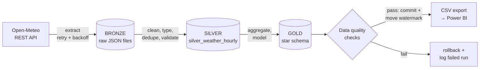
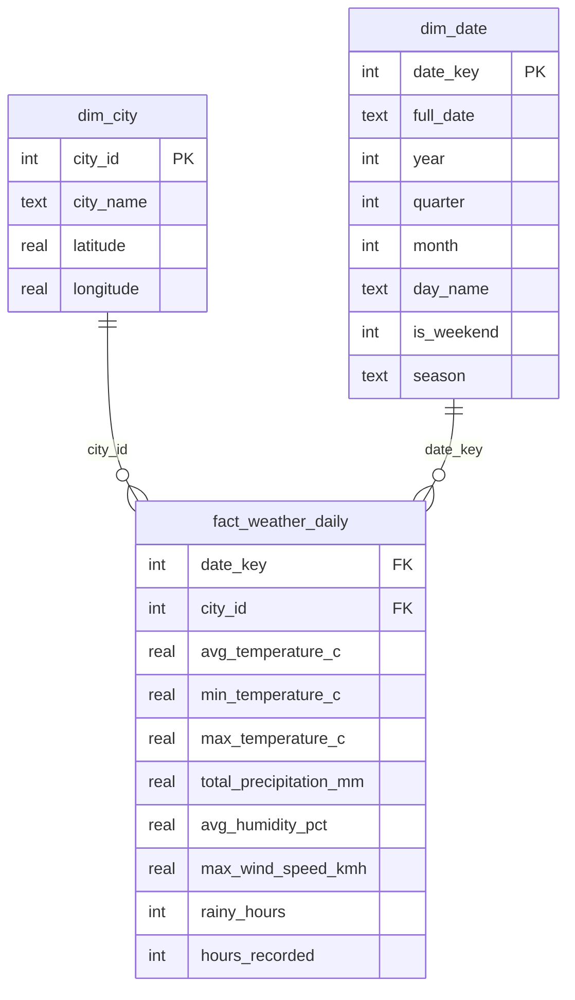

# Azerbaijan Weather Data Pipeline

An end-to-end, incremental **ELT pipeline** that ingests hourly weather data for five Azerbaijani cities from a public REST API, processes it through a **medallion architecture (Bronze → Silver → Gold)** and publishes an analytics-ready **star schema** for Power BI.

Built to demonstrate core data engineering practices: incremental loading with watermarks, idempotent re-runs, transactional loads, automated data quality gates, orchestration with Apache Airflow and automated tests.

## Architecture



| Layer | Storage | Content |
|---|---|---|
| **Bronze** | `data/bronze/<city>/<start>_<end>.json` | Untouched API responses plus extraction metadata. Replayable: silver and gold can be rebuilt without calling the API again. |
| **Silver** | `silver_weather_hourly` | One clean row per city per hour: renamed, typed, out-of-range values nulled, empty rows dropped, duplicates removed. Each row keeps lineage to its bronze file. |
| **Gold** | `dim_city`, `dim_date`, `fact_weather_daily` | Star schema with daily aggregates (avg/min/max temperature, rainfall, humidity, wind, rainy hours). |

### Gold data model



## Key engineering features

- **Incremental loading:** a per-city watermark (`pipeline_watermark`) stores the last loaded date, so each run only requests new days.
- **Idempotent:** silver uses `INSERT … ON CONFLICT DO UPDATE`; gold deletes and re-aggregates only the dates touched in the run. Re-running never creates duplicates.
- **Backfills:** `--start/--end` reprocesses any date range safely.
- **All-or-nothing loads:** silver, gold, quality checks and the watermark update run in a single transaction. A failure rolls everything back.
- **Data quality gate:** 11 SQL checks (null keys, value ranges, referential integrity, `min ≤ avg ≤ max`, hours per day) must pass before commit.
- **Run auditing:** every run is logged in `pipeline_runs` with status, row counts and error message.
- **Resilient extraction:** HTTP retries with exponential backoff and response validation.
- **Orchestration:** Apache Airflow DAG (`dags/weather_pipeline_dag.py`), daily at 06:00 Baku time.
- **Tests:** 10 unit and end-to-end tests covering cleaning rules, idempotency, incremental loads, backfills, rollback on failure and the API path (mocked).
- **Offline demo mode:** `--sample` generates realistic data (including dirty values) so the project runs without internet.

## Tech stack

Python · pandas · SQL (SQLite) · REST API (requests) · Apache Airflow · unittest

## Project structure

```
├── run_pipeline.py            # CLI entry point
├── pipeline/
│   ├── config.py              # cities, API settings, valid value ranges
│   ├── extract.py             # API → bronze (retry/backoff)
│   ├── transform.py           # bronze → silver (cleaning rules)
│   ├── load_gold.py           # silver → gold star schema (incremental)
│   ├── quality.py             # data quality checks
│   ├── state.py               # watermarks for incremental loads
│   ├── export.py              # gold → CSV for Power BI
│   ├── run.py                 # orchestration + transaction handling
│   └── sample_data.py         # offline sample data generator
├── sql/
│   ├── schema.sql             # all table definitions
│   ├── gold_dim_date.sql      # date dimension
│   ├── gold_fact_weather_daily.sql
│   └── example_queries.sql    # analytics examples (window functions)
├── dags/weather_pipeline_dag.py
└── tests/test_pipeline.py
```

## Quick start

```bash
pip install -r requirements.txt

python run_pipeline.py --sample              # offline demo
python run_pipeline.py                       # real API, incremental
python run_pipeline.py --start 2026-09-01 --end 2026-09-30   # backfill

python -m unittest -v                        # run tests
```

Output: `data/warehouse.db` (SQLite) and `data/gold_csv/*.csv` (load into Power BI and relate `fact_weather_daily` to both dimensions).

## Possible extensions

- Port the transformations to **PySpark** and run them in **Microsoft Fabric** notebooks with Delta tables in a Lakehouse.
- Move the gold layer models into **dbt** with schema tests.
- Add a second source (e.g. daily CBAR exchange rates) and join it in gold.

Data source: [Open-Meteo Historical Weather API](https://open-meteo.com/) (CC BY 4.0).
